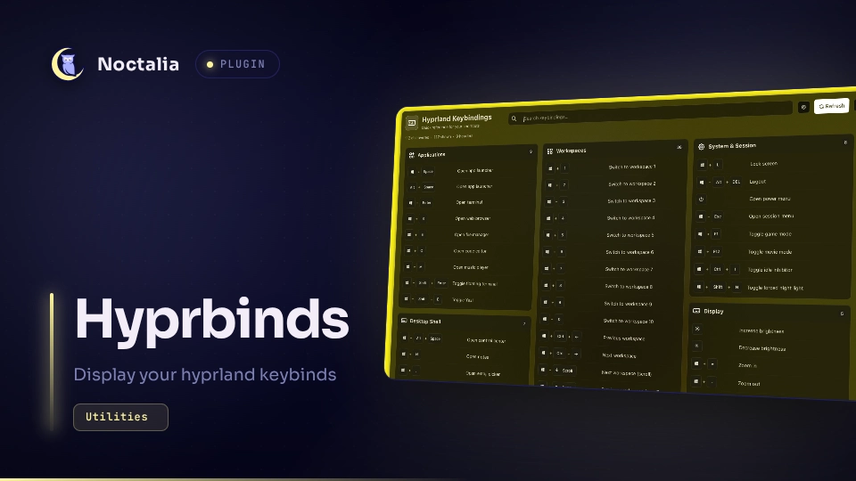

# Hyprbinds

Read-only Hyprland Lua keybinding cheatsheet with search, categories, and a bar
widget. Configuration is never executed or modified.



## Requirements

Noctalia plugin API 43 (v5.4.0), a readable Hyprland Lua configuration,
`fontconfig` (`fc-match`), and a Nerd Font such as Symbols Nerd Font Mono.
Classic `.conf` configurations are unsupported.

API 43 uses `surface_container` and `outline_variant` for the existing fills
and borders, preserving their colors and opacity. The spacious fixed-size
cheatsheet and scrolling behavior are unchanged.

## Usage

Follow the [installation instructions](../README.md#installation), then enable
`vantesh/hyprbinds`. Add **Hyprland Keybindings** to the bar, use `/hyprbinds` in
the launcher, or toggle the panel directly:

```sh
noctalia msg panel-toggle vantesh/hyprbinds:cheatsheet
```

Search bindings inside the panel; the launcher only opens it. **Refresh** rereads
configuration changes; **Escape** closes the panel.

## Settings

Under **Settings → Plugins → Hyprland Keybindings**:

| Setting       | Default                       | Options                             |
| ------------- | ----------------------------- | ----------------------------------- |
| `config_path` | `~/.config/hypr/hyprland.lua` | Main Lua configuration              |
| `super_style` | `windows`                     | `windows`, `apple`, `linux`, `text` |
| `icon_style`  | `auto`                        | `auto`, `nerd`, `text`              |

Missing glyphs fall back to text or native icons. Reload after installing fonts.

## Limitations

- Reads `hl.bind(...)` declarations and literal `require` imports in source order.
  Descriptions use `description` or `desc`; categories use `-- === Name ===`.
- Lists source declarations, not active runtime bindings. Aliases, computed
  imports, and generated shortcuts are not resolved; partial results show diagnostics.
- Results are cached in memory. No file watchers, network access, or plugin writes.

[Local validation](../README.md#local-validation) · [MIT license](LICENSE)
